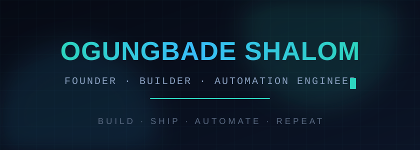
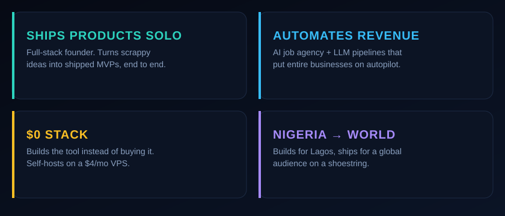
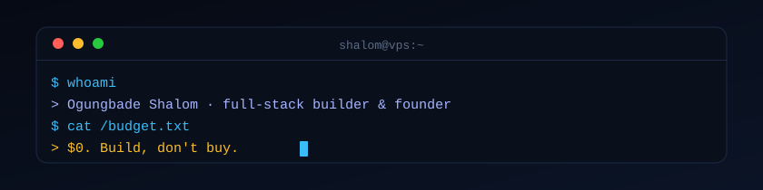

<!-- Hero banner (animated: shimmer title, glow orbs, blinking terminal caret) -->
<picture>
  <source media="(prefers-color-scheme: dark)" srcset="./assets/banner-dark.svg">
  <source media="(prefers-color-scheme: light)" srcset="./assets/banner-light.svg">
  
</picture>

  
  
  

  <a href="#about"><strong>About</strong></a> &nbsp;·&nbsp;
  <a href="#stack"><strong>Stack</strong></a> &nbsp;·&nbsp;
  <a href="#projects"><strong>Projects</strong></a> &nbsp;·&nbsp;
  <a href="#contact"><strong>Contact</strong></a>

 

## About

I'm a full-stack founder and automation engineer who turns scrappy ideas into shipped
products and puts whole businesses on autopilot. I build production systems solo,
iterate fast, and ship real.

I'm allergic to paying for tools I can build myself. My philosophy is "$0 or die":
scrape it, self-host it, or write it before I subscribe to it. Everything I run fits on
a single $4/mo Hetzner VPS, including multi-tenant SaaS and automated job submission.

<picture>
  <source media="(prefers-color-scheme: dark)" srcset="./assets/features-dark.svg">
  <source media="(prefers-color-scheme: light)" srcset="./assets/features-light.svg">
  
</picture>

 

## Stack

Node.js, TypeScript, Hono, React, Next.js · Python &amp; FastAPI · PostgreSQL, SQLite ·
LLM pipelines, headless browsers, cron ecosystems · Docker, PM2, reverse proxies, tunnels.

<picture>
  <source media="(prefers-color-scheme: dark)" srcset="./assets/stack-dark.svg">
  <source media="(prefers-color-scheme: light)" srcset="./assets/stack-light.svg">
  
</picture>

 

## Projects

| Project | What it is |
|---|---|
| **[ApplyOS](https://github.com/OgungbadeShalom/ApplyOS)** · *TypeScript* | Autonomous job-hunt desktop app. Discover jobs, get ATS-scored tailored resumes, apply through a safe visible browser, track interviews from your inbox. |
| **[Job Application Agency](https://github.com/OgungbadeShalom/job-application-agency-pipeline)** · *TypeScript* | Multi-tenant AI job pipeline. Scrapes job boards, auto-tailors resumes per role, submits applications, tracks every one across admins, workers, and clients. |
| **[Portfolio Projects](https://github.com/OgungbadeShalom/portfolio-projects)** · *Python + TS* | 20-part portfolio: CLI tools, web apps, and services in Python and TypeScript. |
| **[English Novelist](https://github.com/OgungbadeShalom/english-novelist-english-fork)** · *skill* | English-fiction adaptation of the chinese-novelist skill. Full 4-phase AI novel-writing workflow for English-language fiction. |

I also build single-purpose scraping APIs, job-board scrapers, and client-acquisition
tooling that my own products run on. If it's a recurring task, it probably runs on a cron.

 

## Contact

- **Email** [badeshalom@gmail.com](mailto:badeshalom@gmail.com)
- **LinkedIn** [Ogungbade Shalom](https://www.linkedin.com/in/ogungbade-shalom-904201289/)
- **🎓 Background** B.Sc. Software Engineering · Babcock University

 

<picture>
  <source media="(prefers-color-scheme: dark)" srcset="./assets/divider-dark.svg">
  <source media="(prefers-color-scheme: light)" srcset="./assets/divider-light.svg">
  
</picture>

  Building, shipping, automating · one $4 VPS at a time.

